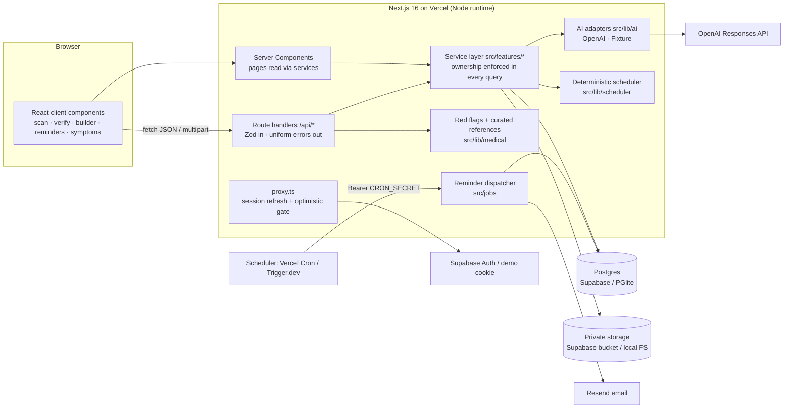

# Architecture

## Request flow: scan → schedule

1. **Upload** `POST /api/documents/upload`: auth, rate limit, magic-byte sniff, then store at `<userId>/<docId>.<ext>` and insert a `documents` row.
2. **Extract** `POST /api/documents/:id/extract`: the document row is claimed atomically (`pending|failed → processing`). The provider runs, Zod validates its output, `normalizeExtraction` enforces invariants, and an immutable `extractions` row is inserted. Failures set `failed`, and the error carries a `retryable` flag.
3. **Verify** `PATCH /api/extractions/:id/verify`: the user's snapshot goes into `verified_fields`. The response includes `assessSchedulability(...)`.
4. **Preview** `POST /api/schedules/preview`: dry run of the engine with user-chosen times.
5. **Create** `POST /api/schedules`: re-validates everything server-side, then inserts the schedule and its events in one transaction. A partial unique index allows only one live schedule per extraction, and `(schedule_id, scheduled_at)` is unique.
6. **Remind**: pages list events in the user's zone. The dispatcher marks due events delivered or missed and records each delivery attempt.

## Boundaries

- **Trust boundary:** everything from the client and the model is untrusted. It is Zod-validated on entry, and the model's output is never used directly to change schedules.
- **Server/client:** pages are Server Components that call services directly. Interactive pieces are client components that call `/api/*` through `apiFetch`, which parses the uniform error body.
- **Swappable infrastructure:** `getDb()` picks postgres-js or PGlite, `getDocumentStorage()` picks Supabase or local, and `getExtractionProvider()` picks OpenAI or fixtures. Tests inject their own.

## Time

All instants are `timestamptz` (UTC). Schedules store the IANA zone they were created in. The engine converts local wall-clock times to UTC per day, so a reminder stays at 08:00 local across DST changes. Display always uses `formatInTimeZone`.
