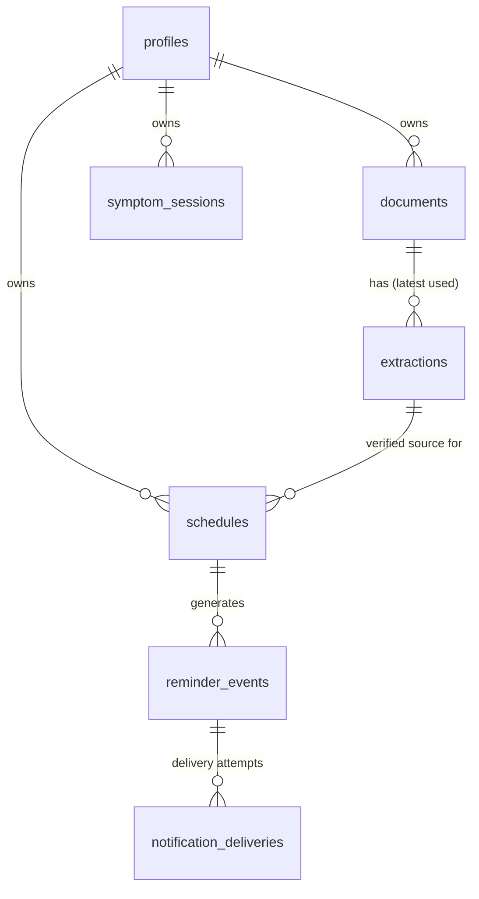

# Data model

Source of truth: `src/lib/db/schema.ts`. Migrations: `drizzle/migrations`. RLS: `supabase/policies/001_rls_and_storage.sql`.

| Table | Key columns | Notes |
|---|---|---|
| `profiles` | `id` (= `auth.users.id`), `timezone` (IANA), `notification_preferences` jsonb | Created on first sign-in (`ensureProfile`). |
| `documents` | `user_id`, `storage_path` (unique, `<user>/<id>.<ext>`), `file_type`, `file_size`, `sha256`, `extraction_status` (pending/processing/completed/failed), `deleted_at` | Soft-deleted; the stored file is removed immediately. |
| `extractions` | `document_id`, `model_identifier` (`openai:<model>` / `fixture:<id>`), `extracted_fields` jsonb (**immutable**), `evidence_spans`, `validation_status`, `verified_fields` jsonb (user snapshot), `verified_at` | Raw AI output and user corrections are stored separately. |
| `schedules` | `user_id`, `extraction_id`, `medicine_name`, `confirmed_instructions` jsonb, `timezone`, `start_date`, `end_date`, `status` (draft/active/paused/completed/cancelled) | Partial unique index: one live schedule per extraction. |
| `reminder_events` | `schedule_id`, `user_id` (denormalised for RLS/queries), `scheduled_at` (UTC), `status` (scheduled/delivered/acknowledged/missed/cancelled), `delivered_at`, `acknowledged_at` | Unique `(schedule_id, scheduled_at)` makes generation idempotent. |
| `notification_deliveries` | `reminder_event_id`, `channel`, `attempt_count`, `delivery_status` (pending/sent/failed/skipped), `provider_message_id`, `last_error` | Unique `(reminder_event_id, channel)` prevents double sends. |
| `symptom_sessions` | `user_id`, `structured_input` (no free text stored), `reference_ids`, `generated_summary`, `safety_status` | Audit of what information was shown. |

Indexes: ownership + time on `documents`, `symptom_sessions`, `schedules`, `reminder_events(user_id, scheduled_at)`, and the due-queue `reminder_events(status, scheduled_at)`.

**Schedule lifecycle:** `active ⇄ paused`; `active|paused → cancelled` (future events cancelled). `completed` is reserved for a job that closes finished courses (not yet implemented).
